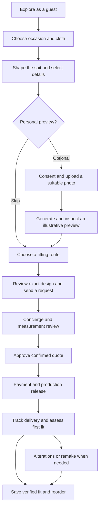

# NYONI suit experience — journey specification

Created 18 October 2026. **Proposed product specification, not a record of implemented features.**

This set maps 28 client journeys, 8 operational journeys and 35 client screens. It turns the existing competitor research into a build brief for a client-facing suit service, including optional personal-photo previews. Each journey identifies its entry, main path, exceptions, outcome, acceptance criteria, evidence and current prototype baseline.

## Read this set

- [Client journeys](CLIENT-JOURNEYS.md) — C01–C28, discovery through reorder and privacy.
- [Service journeys](SERVICE-JOURNEYS.md) — O01–O08, the staff work behind the client experience.
- [Screens and states](SCREENS-AND-STATES.md) — screen inventory, records, state transitions and cross-cutting acceptance scenarios.
- [Coverage matrix](COVERAGE.csv) — one row per journey for planning and tracking.
- [Structured specification](journeys.json) — the same journey and screen inventory in machine-readable form.

## Experience map

Draft saving, support and privacy controls are available across the relevant steps. Changing a design after generating a personal preview marks that preview as outdated. A preview never certifies measurements or fit.

## Who the journeys serve

| Person | Main need | Journeys |
|---|---|---|
| First-time visitor | Understand choices without committing to an account | C01–C07 |
| Client using their photo | See an illustrative look with control over private imagery | C08–C11 |
| Returning client or member | Resume, compare and reuse verified information | C12–C16, C26 |
| Client preparing for a fitting | Get reliable guidance and a clear next step | C15–C20 |
| Client placing an order | Approve exact specifications and understand progress | C19–C23 |
| Client needing help | Reach an owner and follow a correction to completion | C20, C24–C25 |
| Client managing personal data | Remove photos, request data and close access | C11, C27 |
| Wedding or group organizer | Coordinate a shared look without accessing private profiles | C28 |
| Concierge, tailor and operations team | Keep approvals, ownership and production records consistent | O01–O08 |

## Recommended build sequence

Release labels in individual cards indicate scope, not existing implementation or a delivery promise.

1. **Make the core design and request journey dependable.** Build C01–C07, C12 and C19 with approved catalogue data, explicit compatibility rules, exact supplier references, durable drafts and a real submission receipt. Establish O01–O02 alongside it. Prioritize one approved silhouette and a small, complete fabric range over a large incomplete catalogue.
2. **Prove the personal-photo experience separately.** Build C08–C11 with O06 and O08 before inviting clients to upload photos. Benchmark providers using consenting participants and complete garment references. Verify identity consistency, garment fidelity, failure handling and deletion behavior before expanding. Keep the studio model available throughout.
3. **Connect the fitting and concierge service.** Build C13–C18 and C20 with verified accounts, fit-profile revisions and case ownership; establish O03–O04. Start appointment handling as a request unless real availability and booking confirmation are integrated. Enable member benefits only with an authoritative eligibility source.
4. **Enable commerce and fulfillment after operational readiness.** Build C21–C27 with O05 and O07, confirmed pricing, payment receipts, production release and tracking. Aftercare must be ready before accepting orders. Privacy controls required for earlier phases must ship with those phases; they do not wait for commerce.
5. **Expand into group coordination.** Build C28 once individual ordering and fit journeys are dependable. Maintain separate consent, measurements and payment authority for each participant.

The minimum coherent pilot is a guest design → saved specification → real concierge request, plus a separately validated optional photo preview. It is not necessary to launch checkout, a calendar or group ordering to test that pilot.

## Design and service rules

- Show a large, stable human-model preview, focused choice panels and persistent design context. Keep changes predictable and let clients inspect the actual fabric and components.
- Treat the exact selected specification as the production record. An illustrative photo is a visualization of a particular revision, never its replacement.
- Make optional steps genuinely optional: a photo, an account and a tour must not block basic design exploration.
- Use accurate state language: saved locally versus saved to an account; request received versus appointment booked; quote approved versus payment received; refund approved versus funds returned.
- Preserve work through back navigation, failed requests, unavailable fabrics and delayed generation. Offer explicit recovery paths.
- Give each service case a responsible owner. Approval, escalation and correction journeys matter as much as the initial design screen.

## Decisions needed before the affected features ship

These are implementation inputs, not reasons to delay building the core pilot.

| Decision | Required before |
|---|---|
| Approved catalogue, stock source, prices, cloth repeat/scale and compatibility | Publishing selectable products and quotes |
| Supported tailoring choices and approved visual assets | Claiming the preview reflects those choices |
| Photo provider, consent text, access controls and verified retention/deletion behavior | Client photo uploads |
| Measurement workflow, units and qualified reviewer | Accepting remote fit profiles |
| Service locations, appointment ownership and calendar source | Offering booking confirmation |
| Member eligibility and benefit reservation/redemption rules | Showing usable annual-suit entitlement |
| Lead times, alteration/remake terms and cancellation/refund policies | Accepting paid orders |
| Staff access roles, case escalation and notification channels | Connected concierge service |

## Evidence and limits

The strongest observed interface benchmark was Suitsupply; the research also covered Hockerty, Proper Cloth, Indochino and Huntsman. Review findings contributed confidence, support, deadline and aftercare requirements. Review ratings are snapshots, and the sampled reviews are not a representative satisfaction survey. Additional brands mentioned in review research were not all walked through in the UI audit.

- Competitor walkthroughs — `competitor-audit-2026-10-13/COMPETITOR-WALKTHROUGHS.md` (from the research workspace, not in this repository)
- Competitor build brief — `competitor-audit-2026-10-13/NYONI-BUILD-BRIEF.md` (from the research workspace, not in this repository)
- Screenshot index — `competitor-audit-2026-10-13/SCREENSHOT-INDEX.md` (from the research workspace, not in this repository)
- Review findings — `COMPETITOR-REVIEW-FINDINGS-2026-10-18.md` (from the research workspace, not in this repository)
- Personal-suit experience plan — `personal-suit PLAN.md` (from the research workspace, not in this repository)
- Rendering research — `rendering-research/FINDINGS.md` (from the research workspace, not in this repository)

Journey evidence references such as SS01 identify the existing audit, not a claim that a competitor implements our entire proposed journey. New personal-photo behavior is a NYONI proposal requiring validation. No claim of accurate fit, calibrated body scanning, instantaneous generation or a fully rendered 360-degree view is made.

The current prototype supports portions of the design flow and local saving. It does not yet supply the connected service and private-photo systems specified here. This documentation does not deploy changes or create a WordPress package.
